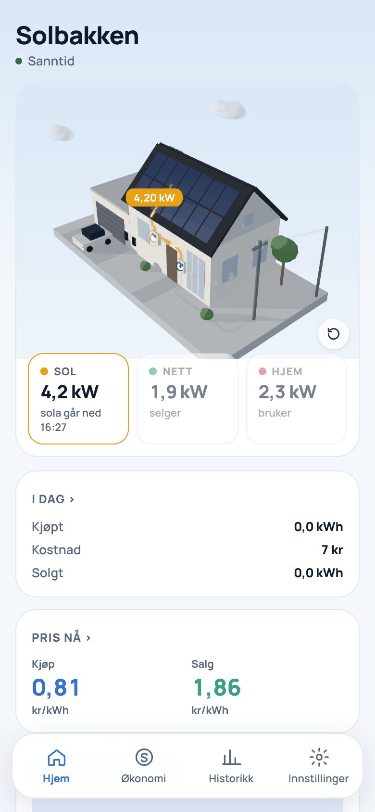
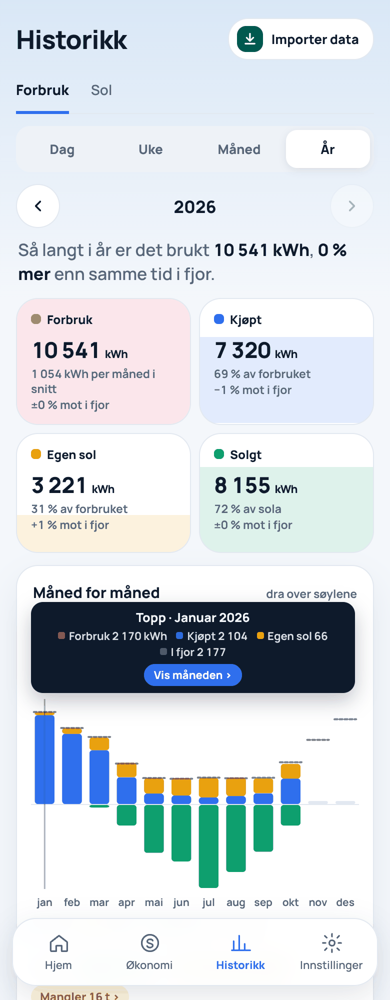
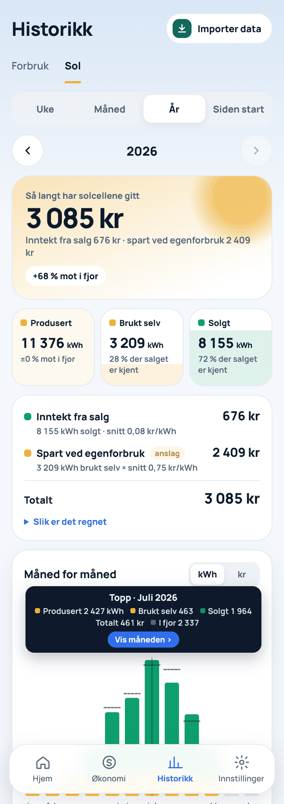
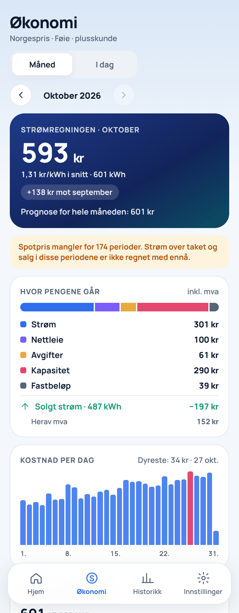
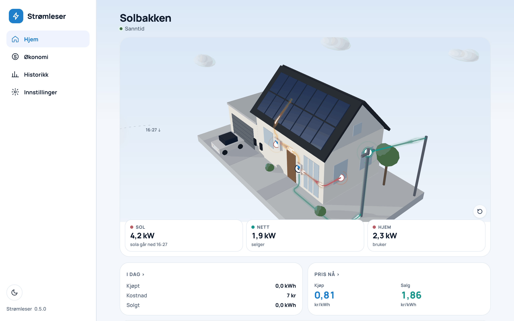
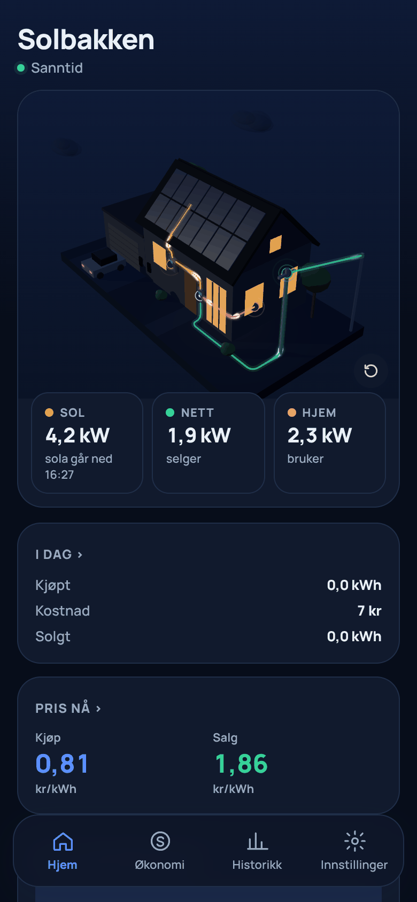
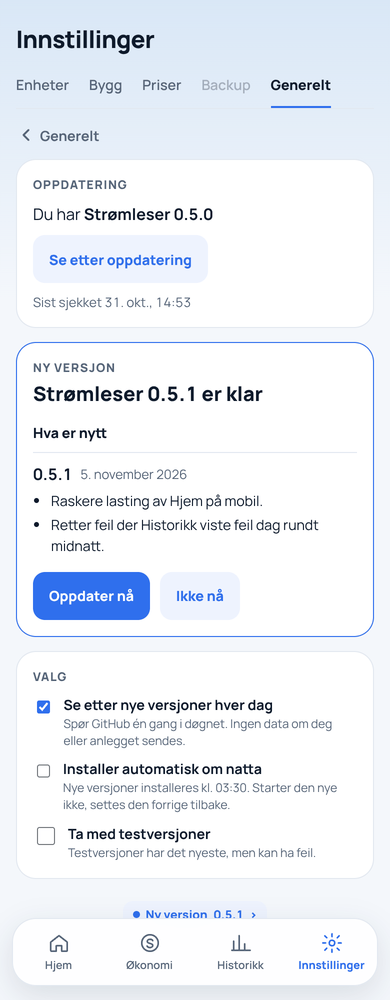

# Strømleser

Strømleser samler solcelleanlegg, AMS-måler, elbilladere og biler i ett grensesnitt, og regner ut hva strømmen faktisk koster: Norgespris eller spot, strømstøtte, nettleie, kapasitetstrinn, avgifter og salg av solstrøm.

Motoren kjører hjemme hos deg (Raspberry Pi, Docker, Unraid eller Linux). Dataene dine blir der.

> [!WARNING]
> **Under utvikling – bruk på eget ansvar.** Strømleser er ikke ferdig, og versjon 1.0 er ikke klar. Funksjoner kan endre seg, og tall for kostnader og solinntekt er beregninger som kan avvike fra fakturaen din. Det gis ingen garanti (se lisensen). Ta vare på kopier av data du er avhengig av, for eksempel eksporter fra Elhub og Solar Assistant.

<p>
  
  
  
  
</p>



<p>
  
  
</p>

<sub>Skjermbildene viser fiktive data (bygget «Solbakken» og et oppdiktet målepunkt).</sub>

## Hva den gjør

**Hjem**
- Strømmen akkurat nå fra sol, nett og hjem, med kometer som viser retningen. Effekten står på kortene, og et trykk på et kort viser kW langs ledningen.
- Huset i 3D, som kan snus, vippes og zoomes. Lys og skygger kommer fra sola på riktig plass etter posisjon, klokkeslett og hvilken vei huset vender. Du kan velge mellom husmalene Saltak og Funkis.
- Kostnad i dag, pris nå (kjøp og salg) og den siste timen fra nettet. Natt-modus og lyst/mørkt tema.

**Økonomi**
- Strømregningen for måneden og i dag: strøm etter avtalen (Norgespris med tak, spot eller fastpris), strømstøtte, nettleie (energiledd, kapasitetstrinn og fastbeløp), avgifter og mva.
- Salg av solstrøm: spotpris time for time, påslag og plusskunde-godtgjøring. Prognose for hele måneden.
- Satser per bygg med «gjelder fra», med standardsatser og kilder for 2023–2026.

**Historikk**
- Forbruk, kjøpt, egen sol og solgt per dag, uke, måned og år, sammenlignet med samme tid i fjor.
- Sol: produsert, brukt selv og solgt, og hva solcellene har gitt i kroner, både per periode og siden start.
- Import av timeverdier fra Elhub (CSV eller zip), Solar Assistant-totaler (dag og måned) og månedstall lagt inn for hånd. Oversikt over hvilke måneder som har data.

**Enheter og bygg**
- AMS-leser fra amsleser.no (Pow-K) og Solar Assistant, over det lokale nettet.
- «Test tilkobling» før lagring, med bevis (ekte verdier) og konkrete forslag ved feil. Nattlig test kl. 03:00 og «Test nå».
- Flere bygg (bolig og fritidsbolig) med målepunkt-ID (sjekkes), posisjon, husmal og retning.

**Drift**
- Oppdatering fra nettsiden: Strømleser ser etter nye versjoner og viser hva som er nytt. Ett trykk laster ned, sjekker (SHA-256) og installerer, og setter den forrige tilbake hvis den nye ikke starter. Automatisk oppdatering om natta og testversjoner kan velges.
- Lite skriving til minnekortet: sanntid i minnet, og måledata skrives samlet hvert 15. minutt (SQLite).
- Passord krypteres (AES-GCM) og vises aldri i API-et.
- Norsk og engelsk.

**Planlagt:** elbillader (Easee), bil (BMW CarData), ladeøkter og refusjonsrapport for firmabil, sikkerhetskopi, og senere Strømleser Sky på strømleser.no.

## Installere på Raspberry Pi eller Linux

Krever et 64-bit system (arm64 eller amd64) med systemd, for eksempel Raspberry Pi OS Lite 64-bit på Pi 4 eller 5.

```bash
curl -fsSL https://raw.githubusercontent.com/ITNorgeConsult/stromleser/main/scripts/install.sh | sudo bash -s -- --low-write
```

Skriptet henter siste versjon fra GitHub og installerer Strømleser som systemd-tjeneste. Det legger også inn oppdateringstjenesten, som brukes av «Oppdater nå» i grensesnittet. Åpne deretter `http://<maskinnavn>.local:8080`.

`--low-write` legger systemloggene i minnet, så minnekortet slites mindre. Det kan sløyfes på SSD.

Har du lastet ned en utgivelse selv: pakk ut `stromleser-vX.Y.Z-linux-arm64.tar.gz` og kjør `sudo ./scripts/install.sh ./stromleser-linux-arm64 --low-write` i mappen.

**Oppdatere:** nye versjoner vises nederst i menyen og under Innstillinger › Generelt › Oppdatering, med en liste over endringene. Installasjoner fra før v0.5.0 må kjøre installasjonen én gang til for å få knappen.

**Avinstallere:** `sudo ./scripts/install.sh --uninstall`. Dataene i `/var/lib/stromleser` beholdes.

## Docker

```bash
docker compose up -d
```

Dataene ligger i volumet `stromleser-data`. Strømleser sier fra når det finnes en ny versjon. Oppdatere: `docker compose pull && docker compose up -d`.

## Unraid

Bruk malen i `deploy/unraid/stromleser.xml`. Dataene ligger i `appdata/stromleser`. Legg appdata på cache-poolen, så kan diskene i arrayet sove.

## Spørsmål og feil

Strømleser utvikles av IT Norge Consult AS. Kildekoden er foreløpig ikke offentlig. Feil og ønsker kan meldes under [Issues](https://github.com/ITNorgeConsult/stromleser/issues). Endringer per versjon står i [CHANGELOG.md](CHANGELOG.md).

## Lisens

Strømleser er gratis å bruke under MIT-lisensen (se [LICENSE](LICENSE)), uten garanti. Navnet «Strømleser» og logoen er varemerker for IT Norge Consult AS.
